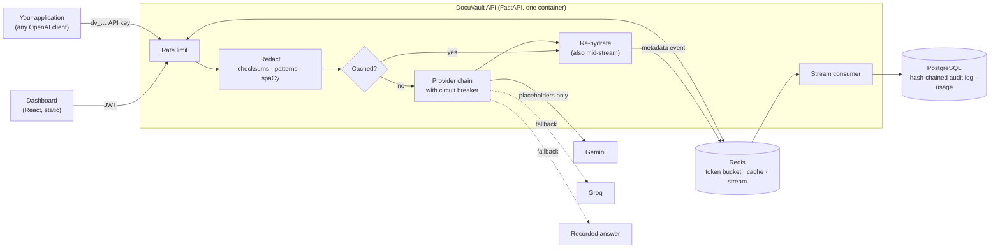

# DocuVault

OpenAI-compatible LLM gateway that minimises German PII before prompts reach an
external LLM, re-hydrates the response, and keeps a tamper-evident audit log.

> **Status:** all five phases are built and tested locally. Not deployed yet and CI has
> not run yet (the repository has no remote so far). Steps: [docs/DEPLOY.md](docs/DEPLOY.md).



Real values exist only in memory for the duration of one request. Providers, the
cache, the logs and the database see placeholders and counts.

## Run locally

```bash
docker compose up --build
```

- Dashboard: http://localhost:5173 ("Try the live demo" opens a guest sandbox)
- API: http://localhost:8000
- OpenAPI docs: http://localhost:8000/docs
- Liveness / readiness: `/healthz`, `/readyz`
- Guest sandbox (no sign-up): `curl -X POST http://localhost:8000/auth/guest`
- Local admin: `admin@beispiel.test` / `local-demo-password` (compose only)

## Use it like the OpenAI API

```bash
TOKEN=$(curl -s -X POST localhost:8000/auth/guest | python3 -c "import json,sys; print(json.load(sys.stdin)['access_token'])")
KEY=$(curl -s -X POST localhost:8000/api-keys -H "Authorization: Bearer $TOKEN" -H "Content-Type: application/json" -d '{"name":"demo"}' | python3 -c "import json,sys; print(json.load(sys.stdin)['key'])")
curl -N localhost:8000/v1/chat/completions -H "Authorization: Bearer $KEY" -H "Content-Type: application/json" \
  -d '{"stream": true, "messages": [{"role": "user", "content": "Ich bin Jonas Weber, IBAN DE89 3704 0044 0532 0130 00."}]}'
```

What happens to a request:

1. Token bucket per API key (atomic Lua script in Redis).
2. PII is replaced by placeholders such as `<PERSON_1>`; one mapping per request, never stored.
3. Response cache lookup, keyed on the redacted prompt.
4. Provider chain: Gemini, then Groq, then a deterministic replay provider. A circuit
   breaker skips a provider that keeps failing.
5. The answer is re-hydrated. In streams, text is held back while it could still be the
   start of a placeholder, so a placeholder split across chunks is never leaked half-way.
6. Only metadata is logged (provider, latency, counts per PII type). An event goes to a
   Redis Stream; a consumer appends it to the tenant's hash-chained audit log and updates
   daily usage. `GET /audit/verify` recomputes the chain and reports any tampering.

Without API keys the gateway runs in replay mode: no network, same behaviour, canned answer.
Set `LLM_MODE=live` with `GEMINI_API_KEY` and/or `GROQ_API_KEY` for real models.

## Checks

```bash
docker compose --profile test run --rm --build test
```

Runs `ruff`, `mypy --strict`, the Alembic migrations and `pytest` (85 % coverage
gate) against real PostgreSQL and Redis containers.

## Redaction benchmark

Detectors: checksum-validated patterns (IBAN mod 97, Steuer-ID ISO 7064), plain
patterns (e-mail, phone, address, date of birth) and spaCy `de_core_news_sm`
for names and places. Scoring is strict: exact type and exact boundaries.
**Leak rate** is the share of PII characters no detector covered.

#### Development templates (detectors were tuned on these)

| PII type | Precision | Recall | F1 | Gold spans |
| --- | ---: | ---: | ---: | ---: |
| `IBAN` | 1.000 | 1.000 | 1.000 | 80 |
| `STEUER_ID` | 1.000 | 1.000 | 1.000 | 60 |
| `EMAIL` | 1.000 | 1.000 | 1.000 | 80 |
| `PHONE` | 0.964 | 1.000 | 0.982 | 80 |
| `ADDRESS` | 1.000 | 1.000 | 1.000 | 60 |
| `POSTAL_CODE` | 0.889 | 1.000 | 0.941 | 80 |
| `DATE_OF_BIRTH` | 1.000 | 1.000 | 1.000 | 60 |
| `PERSON` | 0.969 | 0.978 | 0.974 | 320 |
| `LOCATION` | 0.968 | 1.000 | 0.984 | 60 |

Leak rate (PII characters left unredacted): **0.64%** over 540 documents.

#### Held-out templates (never used for tuning)

| PII type | Precision | Recall | F1 | Gold spans |
| --- | ---: | ---: | ---: | ---: |
| `IBAN` | 1.000 | 1.000 | 1.000 | 20 |
| `STEUER_ID` | 1.000 | 1.000 | 1.000 | 20 |
| `EMAIL` | 1.000 | 1.000 | 1.000 | 20 |
| `PHONE` | 1.000 | 1.000 | 1.000 | 40 |
| `ADDRESS` | 1.000 | 1.000 | 1.000 | 60 |
| `POSTAL_CODE` | 0.727 | 1.000 | 0.842 | 40 |
| `DATE_OF_BIRTH` | 1.000 | 0.500 | 0.667 | 40 |
| `PERSON` | 0.923 | 0.975 | 0.948 | 160 |
| `LOCATION` | 0.679 | 0.950 | 0.792 | 20 |

Leak rate (PII characters left unredacted): **3.69%** over 200 documents.

How to read this:

- The corpus is synthetic (generated values, fixed sentence templates). Real
  e-mails and tickets are messier; expect lower recall there.
- Detectors were tuned on the development templates. The held-out templates
  were written afterwards and never tuned on, so that table is the more honest
  one. Known gap it exposes: a date of birth written as "am 12.03.1985 geboren"
  (date before the keyword) is missed.
- Low `POSTAL_CODE` and `LOCATION` precision means over-redaction of ordinary
  words ("57199 Exemplare"), not a leak.
- CI fails if any score drops below `backend/benchmark/thresholds.json`.

```bash
docker compose --profile test run --rm test python -m benchmark
```

## Kubernetes

A Helm chart lives in `deploy/helm/docuvault`. The `k8s-smoke` workflow installs it on a
[kind](https://kind.sigs.k8s.io/) cluster inside the CI runner, waits for the pod and
sends a request through it, so the manifests are exercised without a paid cluster.

```bash
helm install docuvault deploy/helm/docuvault --set existingSecret=docuvault-env
```

The pod runs as a non-root user with a read-only root filesystem and no Linux
capabilities; migrations run in an init container; `/healthz` and `/readyz` back the
probes. The chart is fixed at one replica: the stream consumer lives inside the API
process ([ADR 0004](docs/adr/0004-audit-chain-and-event-consumer.md)).

## Operations

- **Logs:** JSON, one line per request, with a request id (`X-Request-ID`). No prompt
  text, only placeholders, ids and counts.
- **Metrics:** `GET /metrics` in Prometheus format (request counts and durations by
  route, gateway calls by provider and cache use, redactions by type). Off unless
  `METRICS_TOKEN` is set; then it needs that token as a bearer token. Locally:
  `curl -H "Authorization: Bearer local-metrics-token" localhost:8000/metrics`
- **Guest budget:** all guest sandboxes share a daily number of live LLM calls
  (`GUEST_DAILY_LLM_CALLS`). Beyond it they get the recorded answer.
- **Behind a proxy:** set `TRUSTED_PROXY_HOPS` so rate limits count visitors, not the proxy.

## Limitations

- **Detection is not complete.** On the held-out benchmark 3.69 % of PII characters
  stay unredacted. This is PII minimisation, not a guarantee, and not a statement
  about legal compliance.
- **The audit chain shows edits, not a full rewrite.** Someone who can rewrite every
  entry and recompute all fingerprints is not detected; that needs an anchor outside
  the database.
- **One container.** The consumer and the circuit breaker keep state in the process.
  Running several replicas needs a separate worker first.
- **A dropped event is lost.** An event that cannot be processed is logged and
  skipped, not retried.
- **A stream cut off by the client leaves no request row.**
- **Free-tier providers may use submitted text to improve their products.** They
  receive placeholders, plus whatever detection missed.
- **Cold starts.** On the free host the first request after a quiet period waits up
  to a minute.
- **Not yet verified:** real Gemini and Groq calls (tests use a fake provider and the
  recording), the GitHub workflows, and the `kind` install. The chart passes
  `helm lint` and schema validation, and the image was run read-only locally.
- **Not built:** document search with `pgvector` (the extension is installed, nothing
  uses it yet), tracing, dashboards for the metrics.

## Stack

Python 3.12 · FastAPI · SQLAlchemy 2 (async) · Alembic · PostgreSQL 17 + pgvector ·
Redis 7 · spaCy · structlog · Prometheus client · React + TypeScript (Vite) ·
Docker · Helm · kind · GitHub Actions
